# Restaurant Management System Documentation

## Session Management

Sessions are displayed for each group currently dining in the restaurant. Each session includes details such as the table number, number of guests, service request status, number of bills open in the session, and tables assigned in the session. The session view displays a TagChip that shows if it is an active session. Only active sessions for the selected location are shown.

**Note:** A gold background indicates that a current Server Request is Present.

### Admin Capabilities

- **End Session**: Admin can close a session which will end the dining experience for that group. This action typically involves finalizing the bill and clearing the table for the next guests.
- **Add New Session**: Admin can initiate a new session for incoming guests. This involves assigning a table, recording the number of guests, and setting up any initial service requests.
- **Close Bill**: Admin can close individual bills within a session. This is useful when guests want to pay separately or when splitting the bill among multiple parties.
- **Create New Bill**: Admin can create additional bills within an existing session. This allows for flexibility in billing, accommodating requests for separate payments or itemized billing.

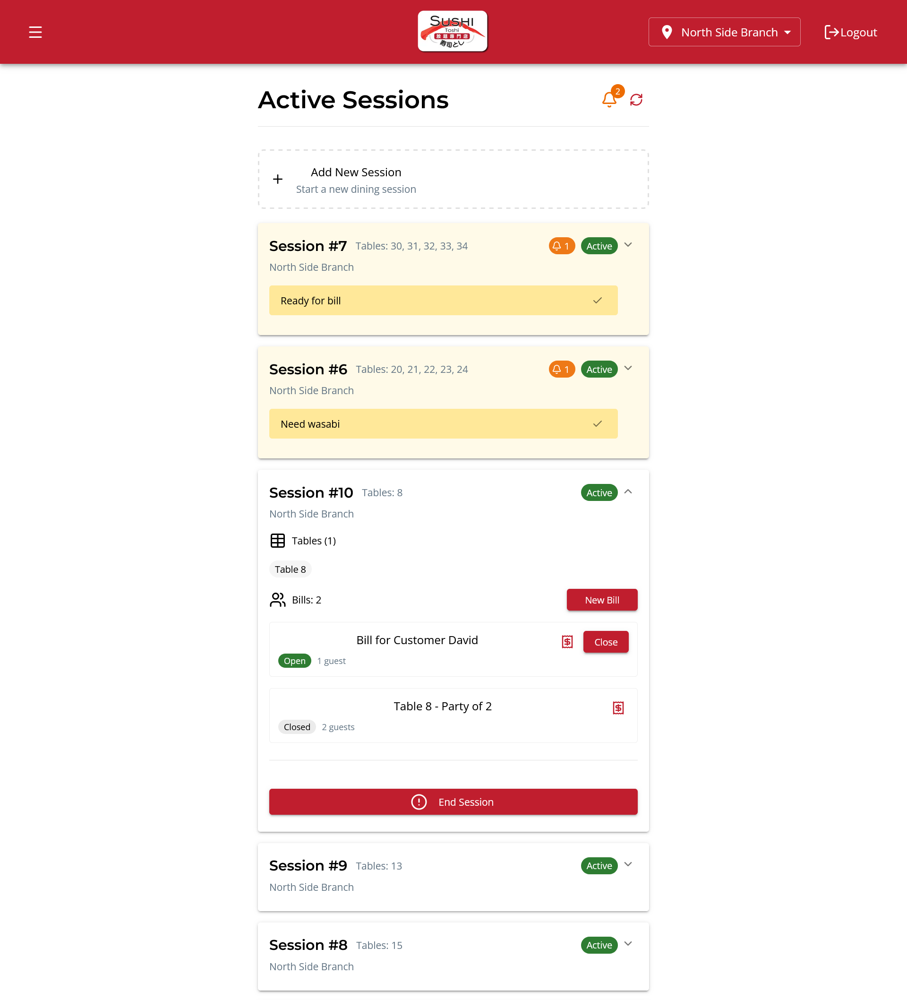

---

## Table Management

Tables are the seating arrangements within the restaurant. Each table has a unique identifier (table number) and can be assigned to different sessions based on guest arrivals. Tables are assigned a QR code that guests can scan to view the menu and place orders. The Table Management section shows if a table is active and if it is currently assigned to an active session, allowing for efficient table management. Tables can be added and removed from Groups as needed. Only tables for the selected location that are not part of a table group are displayed.

### Admin Capabilities

- **Add New Table**: Admin can add a new individual table in the "Add New" dropdown menu. This involves selecting a location for the new table as well as assigning it a table number, seat count and an optional QR code url.
- **Edit Table**: Admin can update the information related to an existing table. This includes changing the table number, seat count or QR code url.
- **Deactivate or Activate Table**: Admin can deactivate or activate an existing table. This action is typically taken when a table is temporarily unavailable for customer use. Only tables that are not linked to a session can be deactivated.
- **Delete Table**: Admin can remove a table from the system. This action is typically taken when a table is permanently removed from the restaurant's seating arrangement. Only tables that are not linked to a session can be deleted.

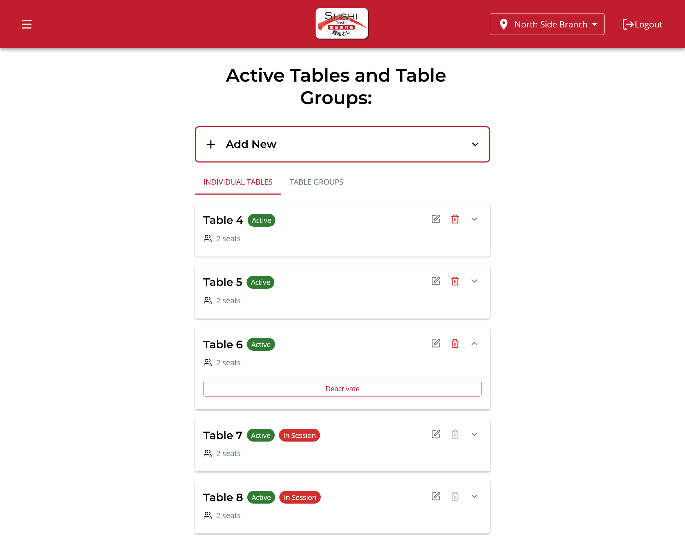

---

## Table Group Management

Table Groups allow Admin to manage larger parties by grouping multiple tables together. This is particularly useful for events or large gatherings where guests need to be seated together. The Table Group Management section provides an overview of all current table groups, including details such as the tables included in each group and the total number of guests. Only table groups for the selected location are displayed.

**Note**: QR codes do not have to be created for table groups. Orders are still associated with the group.

### Admin Capabilities

- **Add New Table Group**: Admin can create a new table group in the "Add New" dropdown menu. This involves selecting a location for the new table group as well as assigning it a unique name.
- **Edit Table Group**: Admin can update the table group name related to an existing table group.
- **Deactivate or Activate Table Group**: Admin can deactivate or activate an existing table group. This action is typically taken when a table group is temporarily unavailable for customer use. Only table groups that are not linked to a session can be deactivated.
- **Add Table to Group**: Admin can select individual tables to add to a table group. Only tables that are not linked to a session can be added to a table group.
- **Remove Table from Group**: Admin can remove individual tables from a table group when they are no longer needed. This allows the tables to be used independently for smaller groups. Only tables that are in a table group that is not linked to a session can be removed from the table group.
- **Delete Table Group**: Admin can delete an existing table group when it is no longer needed. This action will ungroup the tables, making them available for individual seating. Only table groups that are not linked to a session can be deleted.

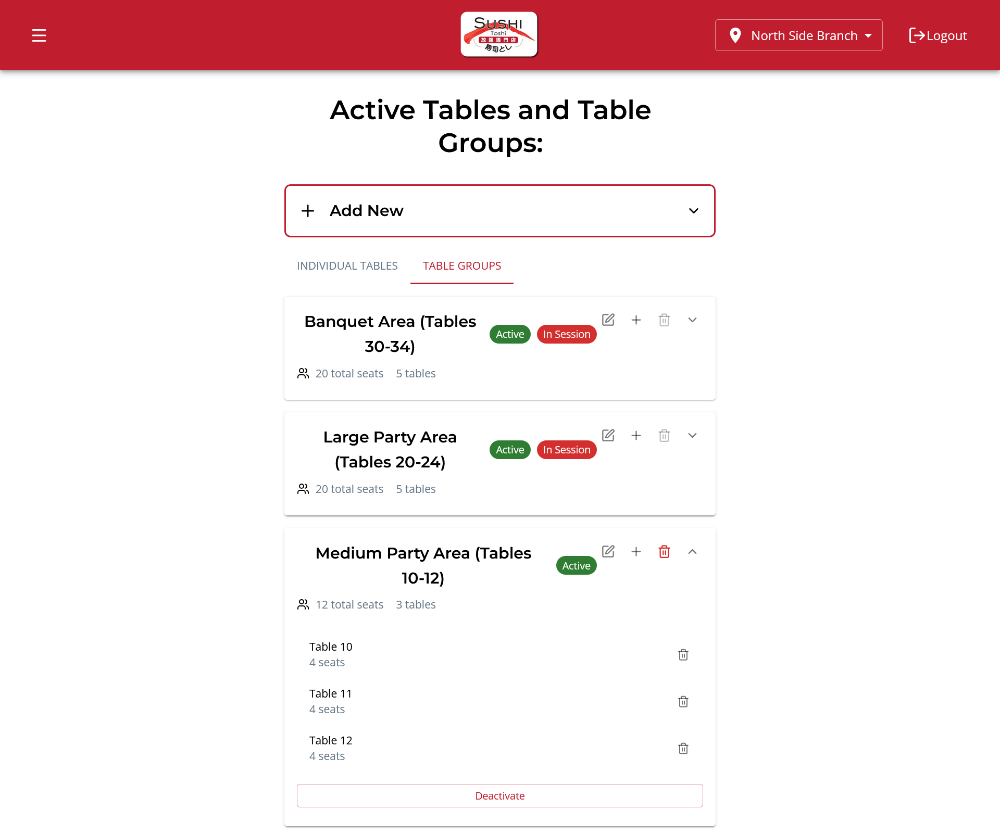

---

## Manage Locations

Manage Locations has two sub-functions: Location Management and Menu Management. Locations are different branches of the restaurant, and each location can have its own menu and settings. Admin can switch between locations to manage sessions, tables, and menus specific to that location.

### Location Management

This section allows the Admin to create and manage different restaurant locations. Each location can have its own settings, menus, and sessions.

#### Admin Capabilities

- **Create/Edit Location** (Notepad Symbol):
  - Location Name: The name of the restaurant location
  - Address: The physical address of the location
  - Contact Information: Phone number and email address for the location
- **Delete Location** (Trash Can Symbol): Admin can delete an existing location. This action will remove the location from the system along with any associated menus and sessions.

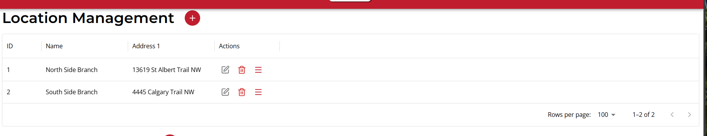
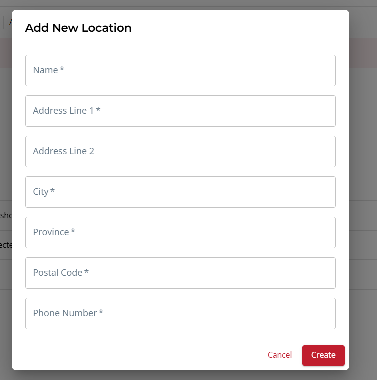

### Menu Management

This section allows the Admin to create and manage menus for each location/company. Menus can be customized with the following options.

#### Admin Capabilities

- **Create/Edit Menu** (Notepad Symbol):
  - Menu Name: The name of the menu (e.g., Breakfast, Lunch, Dinner)
  - Description: A brief description of the menu
  - Start Time: The time when the menu becomes available
  - End Time: The time when the menu is no longer available
  - Active Status: A toggle to activate or deactivate the menu
- **Delete Menu** (Trash Can Symbol): Admin can delete an existing menu. This action will remove the menu from the system and it will no longer be available to customers.
- **Tag Locations to Menus** (GPS Locate Symbol): Admin can assign specific locations to a menu. This allows for location-specific menus, accommodating regional preferences or special offerings.

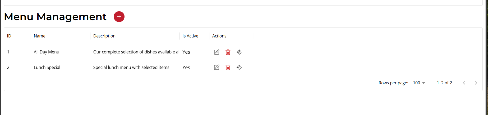
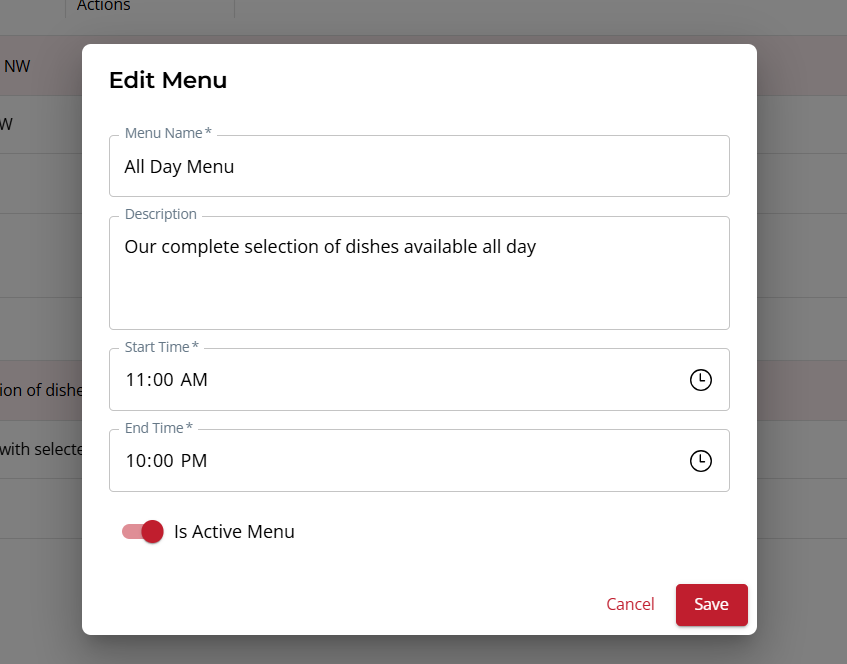
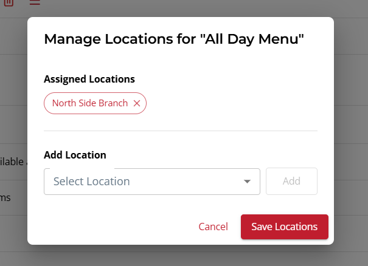

---

## Manage Menu Items

This allows Admin to take the list of items the restaurant offers and create the menu items available to each menu.

### Admin Capabilities

- **Create Menu Item**: Admin can create new menu items by specifying details such as the item name, description, price, category, and any special attributes (e.g., vegetarian, gluten-free).
- **Edit Menu Item**: Admin can modify existing menu items to update information such as price changes, ingredient updates, or description edits.
- **Delete Menu Item**: Admin can remove menu items that are no longer offered by the restaurant. This action will ensure that the item is no longer available for ordering.
- **Assign Menu Items to Menus**: Admin can assign specific menu items to different menus based on the time of day or special offerings. This allows for dynamic menu management tailored to customer preferences.
- **View Menu Items**: Admin can view a list of all menu items, including details such as availability, pricing, and categories. This overview helps in managing the restaurant's offerings effectively.
- **Tag Menu Items**: Menu items can be tagged with different attributes such as "Spicy", "Vegetarian", "Gluten-Free", etc., to help customers make informed choices.
- **Add-On Option**: Menu items can be tagged as an Add-On, allowing customers to customize their orders with additional options.

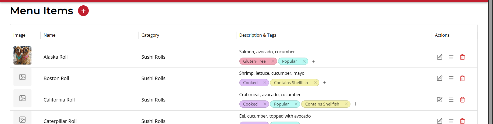
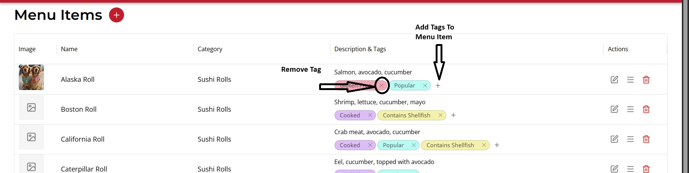
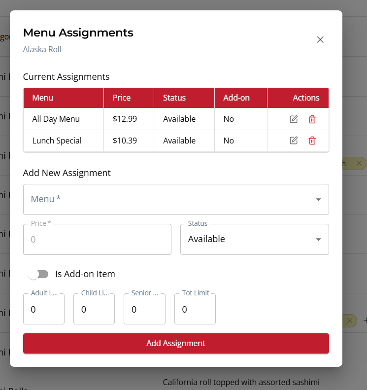
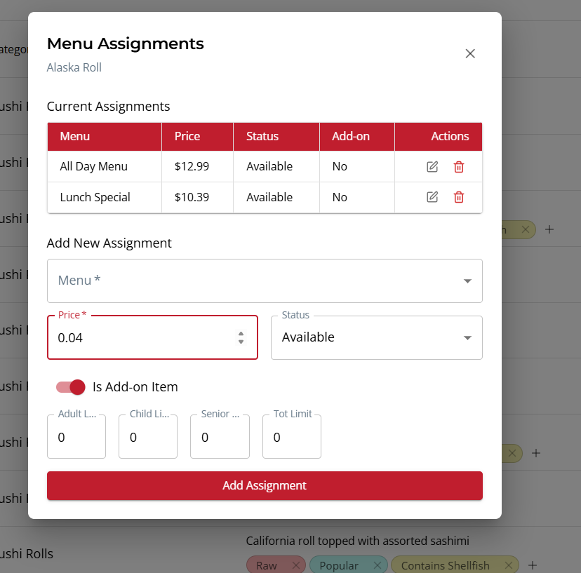
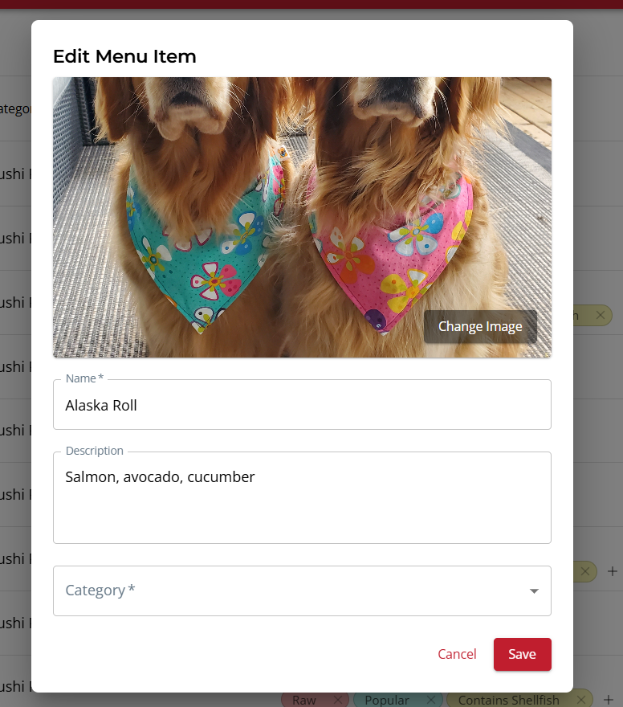

---

## Manage Staff/Users

This section allows the Admin to manage staff members and users who have access to the restaurant management system. Admin can add new staff members, edit existing staff details, and assign roles and permissions based on their responsibilities.

### Admin Capabilities

- **Create/Edit Staff** (Notepad Symbol):
  - Staff Name: The full name of the staff member
  - Role: The role or position of the staff member (e.g., Admin, Staff)
  - Contact Information: Email address for the staff member
- **Delete Staff** (Trash Can Symbol): Admin can delete an existing staff member. This action will remove the staff member's access to the system.
- **Activate/Deactivate Staff/Admin** (Toggle Switch): This will disable the staff/admin from logging into the system without deleting their account.

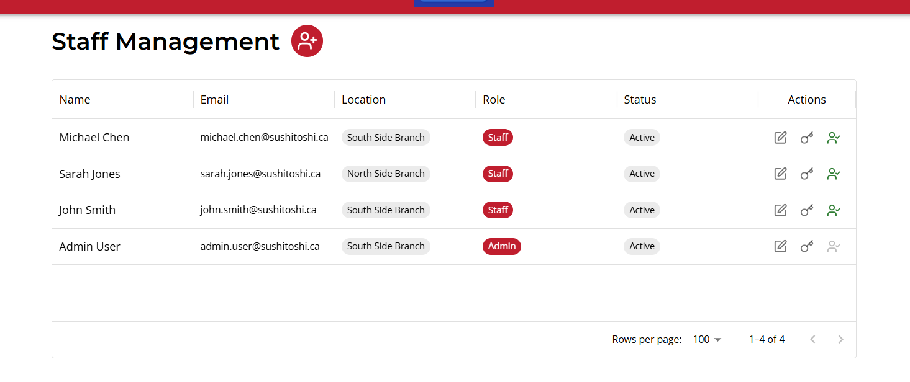
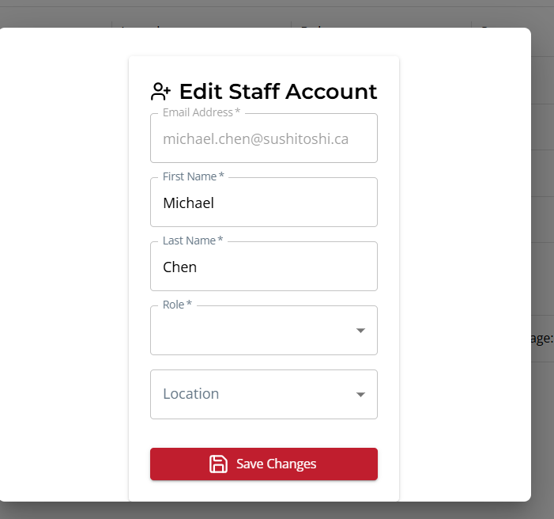
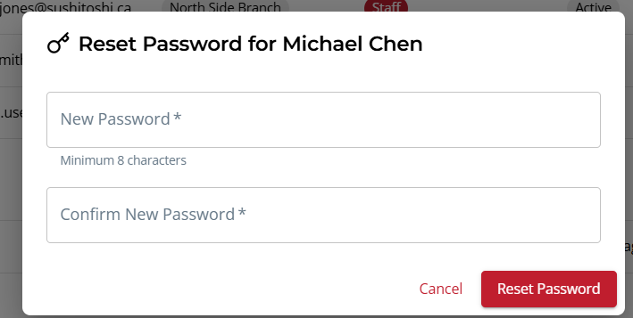
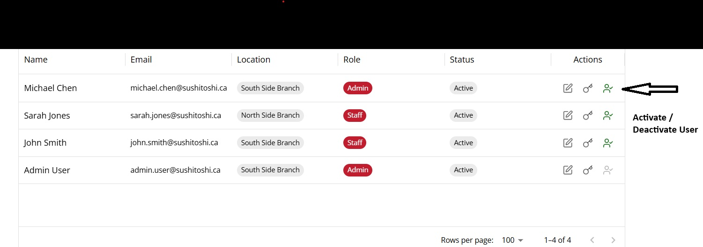

---

## Manage Tags

This allows the Admin to create and manage tags that can be assigned to menu items for better organization and filtering. Tags help categorize menu items based on attributes such as dietary preferences, ingredients, or special features.

### Admin Capabilities

- **Create/Edit Tag** (Notepad Symbol):
  - Tag Name: The name of the tag (e.g., Spicy, Vegan, Gluten-Free)
  - Description: A brief description of the tag
- **Delete Tag** (Trash Can Symbol): Admin can delete an existing tag. This action will remove the tag from the system and it will no longer be available for assignment to menu items.
- **View Assigned Items**: Admin can view a list of menu items that are currently assigned to a specific tag. This helps in managing and organizing menu items effectively.

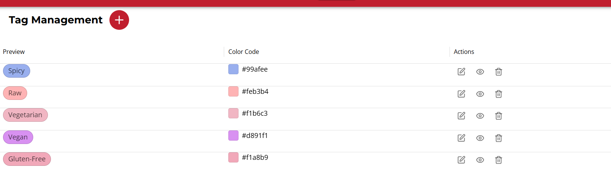
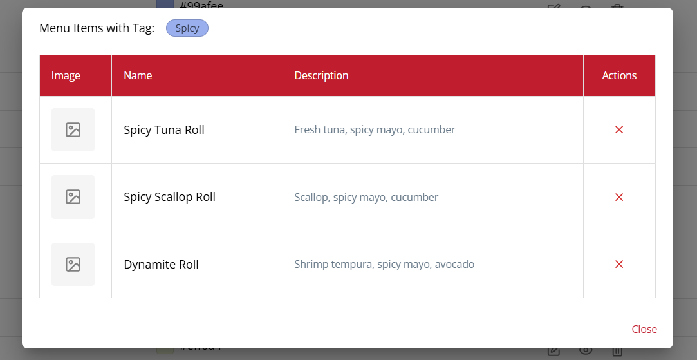

---

## Analytics Dashboard

The Analytics Dashboard provides Admin with insights and data related to restaurant operations. This includes various metrics across different categories.

### Item Performance

- **Top Selling Items**: A list of the most popular menu items based on sales data
- **Bottom Performing Items**: A list of menu items with the lowest sales, helping identify items that may need to be re-evaluated or promoted
- **Total Units Sold for Each Item**: A breakdown of the total number of units sold for each menu item over a specified period

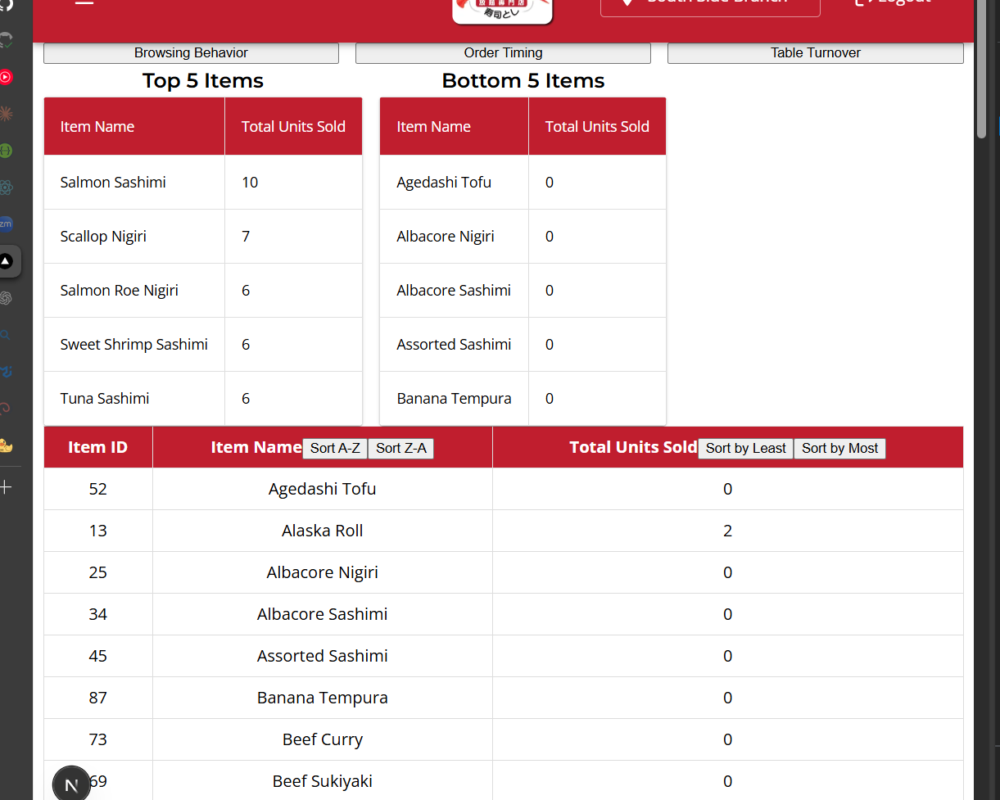

### Browsing Behavior

- **How Long Items Have Been Viewed**: Data on the average time customers spend viewing each menu item
- **Total Views per Item**: A count of how many times each menu item has been viewed by customers

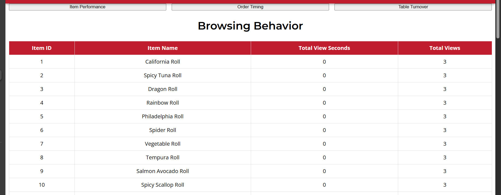

### Order Timing Analytics

Statistics on the time to first order for sessions. This includes three main metrics:

- **Chart for the Last 30 Days**: Shows the average time to first order per day
  - Average Time for 7 Days
  - Average Time for 14 Days
  - Average Time for 30 Days
- **Daily Average Time for the Last 30 Days**
- **Last 25 Sessions Time to First Order**

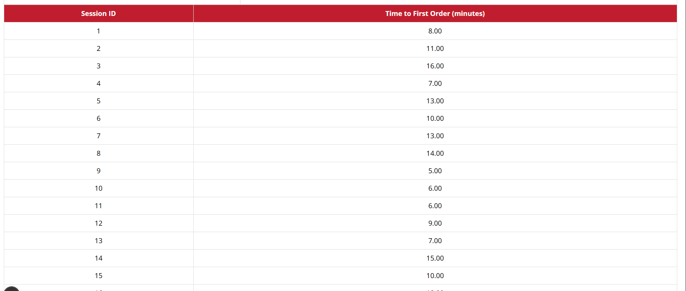
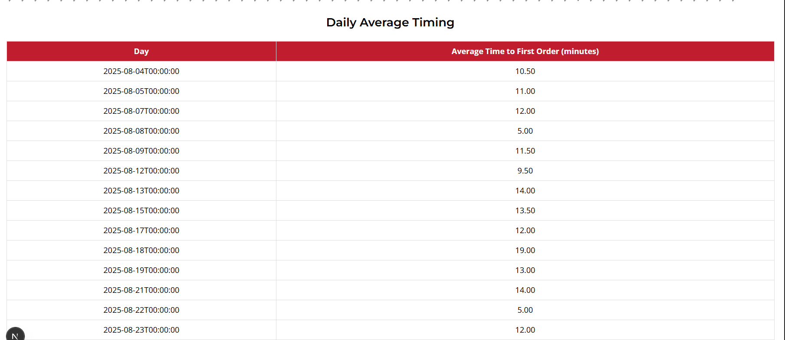
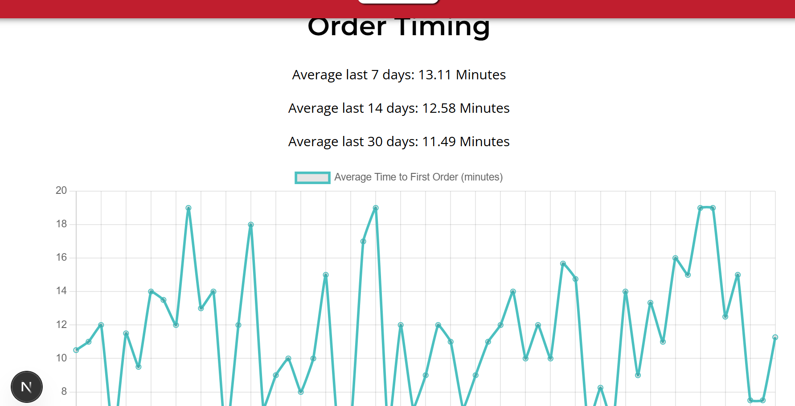
