# Database ERD — Sushi Toshi

Entity Relationship Diagram for the `sushi_toshi_db` database used by the back end.

- **Built from:** the entity classes in `back_end.domain.Entities` and `Enums.cs`
- **Verified against:** the live database schema, Nov 13, 2026

## Viewing and editing

- **GitHub / VS Code:** the diagram below renders automatically in the markdown preview.
- **mermaid.live:** copy everything inside the `mermaid` code block (starting at `erDiagram`) and paste it into https://mermaid.live to edit or export it as PNG/SVG.

## Legend

**Relationship lines**

- Solid line (`--`) = the child's primary key includes the parent's key (used for junction tables).
- Dashed line (`..`) = an ordinary foreign key.

**Cardinality (crow's foot)**

- `||` = exactly one
- `|o` = zero or one
- `o{` = zero or many

**Keys**

- `PK` = primary key, `FK` = foreign key, `UK` = unique key
- `PK, FK` = part of a composite primary key that is also a foreign key

## Notes

- **Types** are the C# property types. "nullable" means the C# property is nullable (`int?`, `DateTime?`, etc.).
- **Enums** are stored as integers. Comments show the stored value for each member (Numbers from 0 unless `Enums.cs` sets a value).
- **Columns with no foreign key** in the database are shown as plain columns with no relationship line:
  - `session_order.Approved_By`
  - `menu_item_view.Menu_Id`, `Location_Id` and `User_Id`
- **Logical link only:** `holidays.Province_Code` matches `locations.Province_Code` but is not a foreign key.
- **Composite unique constraints** are noted in column comments ("unique with ...") rather than marked `UK`, since each column is not unique on its own.

## Keeping this diagram current

When an entity class or migration changes the schema, update the diagram and the verification date above.

## Diagram

```mermaid
erDiagram

    %% Locations & seating
    locations {
        int Location_Id PK
        string Name
        string Address_Primary
        string Address_Secondary "nullable"
        string City
        string Province
        string Postal_Code
        string Phone_Number
        string Province_Code "max 2, default AB"
        datetime Created_At
        datetime Updated_At
    }

    table_groups {
        int TableGroup_Id PK
        string Group_Name "max 255"
        bool Is_Active
        int Location_Id FK
        datetime Created_At
    }

    table_entity {
        int Table_Id PK
        int table_number
        string QR_Code "max 255"
        int seat_count
        bool is_active
        int Location_Id FK
        int TableGroup_Id FK "nullable"
    }

    %% Users & auth
    users {
        int User_id PK
        string Email "max 255"
        string Normalized_email "max 255, = UPPER(Email)"
        int Location_id FK "nullable, current working location"
        string Password_hash "nullable, max 255"
        string GoogleSocial "nullable"
        string First_name "max 100"
        string Last_name "max 100"
        UserRoles Role "Admin=0, Employee=1, Customer=2, Staff=3"
        UserStatus Status "Active=0, Inactive=1, Suspended=2, Deleted=3"
        datetime Created_at
        datetime Last_Interaction_at "nullable"
        bool Is_email_confirmed
    }

    staff_location {
        int User_Id PK, FK
        int Location_Id PK, FK
    }

    auth_action_tokens {
        long Id PK
        int UserId FK
        string TokenHash UK "max 64"
        AuthTokenPurpose Purpose "EmailVerification=1, PasswordReset=2"
        datetime ExpiresAt
        datetime UsedAt "nullable"
        datetime CreatedAt
    }

    %% Menu
    menu {
        int Menu_id PK
        string Name
        string Description
        time Start_time
        time End_time
        bool Is_active
    }

    menu_location {
        int Menu_Id PK, FK
        int Location_Id PK, FK
    }

    Categories {
        int Category_id PK
        string Category_name "max 255"
        string Description
        string image_url "nullable"
        int adult_limit
        int child_limit
        int senior_limit
        int toddler_limit
        int per_order_limit
        OverLimitBehavior over_limit_behavior "Block=0, Charge=1"
    }

    menu_item {
        int item_id PK
        string Name
        string Description
        int Category_id FK
        string image_url "nullable"
        MenuItemStatus Status "Available=0, Unavailable=1, Seasonal=2"
    }

    menu_item_assignment {
        int assignment_id PK
        int menu_id FK
        int item_id FK
        int location_id FK "nullable, NULL = default for all locations"
        int location_key "nullable, computed IFNULL(location_id,0); unique with menu_id + item_id"
        decimal Price
        bool Is_Add_On
        MenuItemStatus Status "Available=0, Unavailable=1, Seasonal=2"
        int Adult_Limit
        int Child_limit
        int Senior_limit
        int Tot_Limit
        int Per_Order_Limit "0 = no cap"
        OverLimitBehavior Over_Limit_Behavior "Block=0, Charge=1"
    }

    tag {
        int tag_id PK
        string tag_name "max 100"
        string tag_color "max 7"
    }

    menu_item_tag {
        int Menu_item_id PK, FK
        int Tag_id PK, FK
    }

    favourite_item {
        int User_Id PK, FK
        int Item_Id PK, FK
        datetime Created_At
    }

    %% Pricing & holidays
    pricing_profiles {
        int Pricing_Profile_Id PK
        int location_id FK, UK "nullable, NULL = default profile"
        int location_key UK "nullable, computed IFNULL(location_id,0)"
        decimal Tax_Rate "5,4"
        decimal Gratuity_Rate "5,4"
        int Gratuity_Min_Party_Size
        decimal Leftover_Fee "10,2"
        string Weekend_Days "max 100, e.g. Friday,Saturday,Sunday"
        bool Apply_Holiday_Pricing
        datetime Created_At
        datetime Updated_At
    }

    pricing_rates {
        int Pricing_Rate_Id PK
        int Pricing_Profile_Id FK "unique with Day_Type"
        PricingDayType Day_Type "Weekday=0, Weekend=1, Holiday=2"
        decimal Adult_Price "10,2"
        decimal Senior_Price "10,2"
        decimal Child_Price "10,2"
        decimal Toddler_Price "10,2"
    }

    holidays {
        int Holiday_Id PK
        string Province_Code "max 2, unique with Date"
        date Date
        date Observed_Date "nullable"
        string Name "max 100"
        HolidaySource Source "Manual=0, Imported=1"
        HolidayStatus Status "Pending=0, Approved=1, Rejected=2"
        datetime Imported_At "nullable"
        int Reviewed_By FK "nullable"
        datetime Reviewed_At "nullable"
        datetime Created_At
    }

    %% Dining session flow
    dining_sessions {
        int Session_Id PK
        int Menu_Id FK
        int Location_Id FK
        int Table_Id FK "nullable"
        int TableGroup_Id FK "nullable"
        datetime Started_At
        datetime Ended_At "nullable"
        datetime First_Order_At "nullable"
    }

    bills {
        int Bill_Id PK
        int Session_Id FK
        string Bill_Name "max 255"
        int Senior_Count
        int Adult_Count
        int Child_Count
        int Tot_Count
        int Total_Count
        BillStatus Status "Open=0, Closed=1, Paid=2, Cancelled=3"
        datetime Created_At
        datetime Closed_At "nullable"
        datetime Requested_At "nullable"
        decimal Leftover_Charge
        bool Started_By_Guest
        bool Counts_Changed_By_Guest
        bool Counts_Locked
        PricingDayType Pricing_Type "nullable, snapshot, Weekday=0, Weekend=1, Holiday=2"
        string Holiday_Name "nullable, snapshot"
        decimal Adult_Price "nullable, snapshot"
        decimal Senior_Price "nullable, snapshot"
        decimal Child_Price "nullable, snapshot"
        decimal Toddler_Price "nullable, snapshot"
        decimal Tax_Rate "nullable, snapshot"
        decimal Gratuity_Rate "nullable, snapshot"
        int Gratuity_Min_Party_Size "nullable, snapshot"
    }

    session_participant {
        int Participant_Id PK
        int Session_Id FK
        int User_Id FK "nullable"
        string User_Name "nullable, max 200"
        datetime Joined_At
        datetime Left_At "nullable"
        int Bill_Id FK "nullable"
    }

    session_order {
        int Order_Id PK
        int session_id FK
        int Bill_Id FK
        int User_Id FK "nullable, guest orders"
        string User_Name "nullable, max 200"
        OrderStatus Status "Pending=0, Processing=1, Delivered=2, Cancelled=3"
        datetime Created_At
        datetime Completed_At "nullable"
        datetime Approved_At "nullable"
        int Approved_By "nullable, no FK"
    }

    order_item {
        int Order_Item_Id PK
        int Order_Key FK "-> session_order.Order_Id"
        int Menu_Id FK
        int Item_Id FK
        int Quantity
        decimal Price_At_Time
        OrderStatus Order_Item_Status "Pending=0, Processing=1, Delivered=2, Cancelled=3"
        datetime Completed_At "nullable"
        ChargeReason Charge_Reason "None=0, OverLimit=1"
    }

    service_request {
        int request_id PK
        int Session_Id FK
        int Table_Id FK
        int Request_By FK
        int Claimed_By FK "nullable"
        string Notes "max 500"
        ServiceRequestStatus Status "Pending=0, Claimed=1, Completed=2, Cancelled=3"
        datetime Created_At
        datetime Claimed_At "nullable"
        datetime Completed_At "nullable"
    }

    menu_item_view {
        long View_Id PK
        int Item_Id FK
        int Session_Id FK
        int Menu_Id "no FK"
        int Location_Id "no FK"
        int User_Id "nullable, no FK"
        datetime Viewed_At
        int View_Seconds
        bool Was_Available
    }

    %% Relationships

    %% Locations & seating
    locations    ||..o{ table_groups        : "has"
    locations    ||..o{ table_entity        : "has"
    table_groups |o..o{ table_entity        : "groups"
    locations    |o..o| pricing_profiles    : "priced by"
    pricing_profiles ||..o{ pricing_rates   : "rate per day type"

    %% Users
    locations    |o..o{ users               : "current location of"
    users        ||--o{ staff_location      : "assigned to"
    locations    ||--o{ staff_location      : "staffed by"
    users        ||..o{ auth_action_tokens  : "owns"
    users        |o..o{ holidays            : "reviews"

    %% Menu
    menu         ||--o{ menu_location       : "offered at"
    locations    ||--o{ menu_location       : "offers"
    Categories   ||..o{ menu_item           : "contains"
    menu         ||..o{ menu_item_assignment : "lists"
    menu_item    ||..o{ menu_item_assignment : "assigned in"
    locations    |o..o{ menu_item_assignment : "overrides"
    menu_item    ||--o{ menu_item_tag       : "tagged"
    tag          ||--o{ menu_item_tag       : "applied to"
    users        ||--o{ favourite_item      : "hearts"
    menu_item    ||--o{ favourite_item      : "hearted as"

    %% Dining session flow
    locations    ||..o{ dining_sessions     : "hosts"
    menu         ||..o{ dining_sessions     : "served in"
    table_entity |o..o{ dining_sessions     : "seats"
    table_groups |o..o{ dining_sessions     : "seats"
    dining_sessions ||..o{ bills            : "split into"
    dining_sessions ||..o{ session_participant : "joined by"
    users        |o..o{ session_participant : "is"
    bills        |o..o{ session_participant : "pays"
    dining_sessions ||..o{ session_order    : "has"
    bills        ||..o{ session_order       : "charged to"
    users        |o..o{ session_order       : "places"
    session_order ||..o{ order_item         : "contains"
    menu         ||..o{ order_item          : "ordered from"
    menu_item    ||..o{ order_item          : "ordered as"
    dining_sessions ||..o{ service_request  : "raises"
    table_entity ||..o{ service_request     : "from"
    users        ||..o{ service_request     : "requests"
    users        |o..o{ service_request     : "claims"
    dining_sessions ||..o{ menu_item_view   : "logs"
    menu_item    ||..o{ menu_item_view      : "viewed"
```

